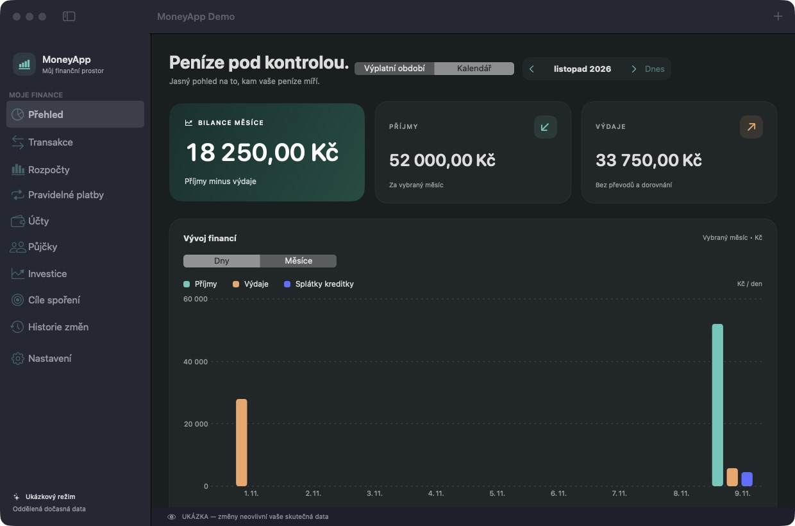
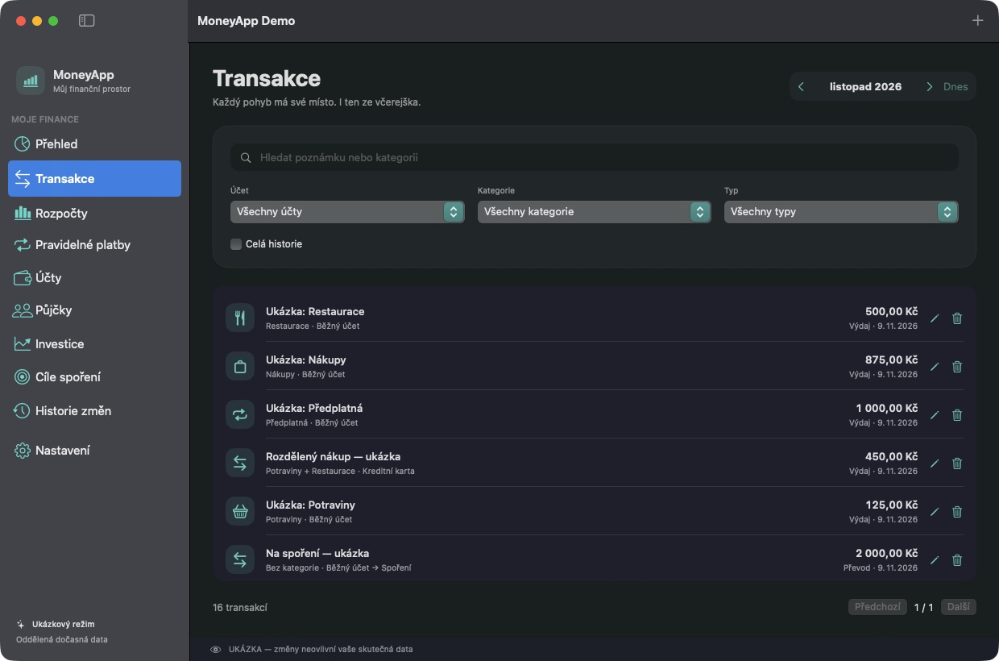

# MoneyApp

**Osobní finance na Macu. Vaše data zůstávají u vás.**

MoneyApp je nativní aplikace ve SwiftUI pro ruční evidenci financí v českých korunách. Účty, transakce, rozpočty a pravidelné platby drží v lokální SQLite databázi — bez registrace, serveru a bankovního připojení.



> Projekt je ve vývoji. Před použitím s vlastními financemi si vytvořte zálohu. Screenshoty obsahují pouze ukázková data.

## Co umí

- Běžné, spořicí i kreditní účty, převody a dorovnání zůstatku.
- Příjmy a výdaje, rozdělení platby mezi kategorie a historie změn.
- Přehled za kalendářní měsíc nebo od výplaty k výplatě.
- Měsíční rozpočty, pravidelné platby a cíle spoření.
- Ruční evidence půjček, splátek a investic.
- CSV export transakcí, úplné JSON zálohy a obnova dat.
- České rozhraní, světlý i tmavý vzhled a klávesové zkratky.

Aplikace neodesílá platby do banky, nestahuje kurzy ani bankovní transakce. Investice a půjčky jsou ruční evidence; nejde o investiční doporučení nebo úvěrovou kalkulačku.

## Spuštění ze zdrojů

Potřebujete **macOS 15+**, **Swift 6.2+** a Xcode nebo Command Line Tools s odpovídajícím SDK. Projekt nemá vzdálené Swift balíčky; používá systémovou SQLite.

Po klonování repozitáře otevřete jeho složku v terminálu:

```sh
swift build
swift run MoneyApp --demo
```

`--demo` vytvoří samostatnou dočasnou databázi a naplní ji ukázkovými daty. Osobní úložiště nemění. Pro běžné použití spusťte `swift run MoneyApp` bez tohoto přepínače.

V Xcode otevřete `Package.swift`, zvolte schéma **MoneyApp** a cíl **My Mac**. Pro testování UI nastavte v argumentech schématu `--demo`.

### Vlastní .app

```sh
bash scripts/build-app.sh
open build/MoneyApp.app
```

Skript vytvoří `build/MoneyApp.app` pro architekturu aktuálního Macu s místním ad-hoc podpisem. Neprovádí Developer ID podepsání ani notarizaci. Pro bezpečnou ukázku sestavené aplikace:

```sh
open -n build/MoneyApp.app --args --demo
```

## Kde začít s úpravami

| Cesta | Účel |
| --- | --- |
| `Sources/MoneyApp/` | SwiftUI obrazovky a koordinace aplikace |
| `Sources/MoneyCore/` | Finanční pravidla, modely, zálohy a SQLite |
| `Sources/CSQLite/` | Napojení na systémovou SQLite |
| `Tests/MoneyCoreTests/` | Testy finančních pravidel a úložiště |
| `Resources/` | Metadata aplikace |
| `scripts/` | Build a generování ikony |

Peníze se počítají v nejmenších měnových jednotkách. Převody nemají navyšovat příjmy ani výdaje. Při úpravách zachovejte přesnost částek, migrace a kompatibilitu záloh.

```sh
swift test
swift format lint --strict --recursive Sources Tests Package.swift scripts/make-icon.swift
```

Testy spouštějte před odesláním změn. Pro reprodukci UI používejte demo režim a do issue nikdy nevkládejte vlastní výpisy nebo databázi.

## Data a zálohy

Osobní databáze se ukládá do `~/Library/Application Support/MoneyApp/finance.sqlite`. Automatické zálohy najdete v podadresáři `Backups`; aplikace uchovává posledních sedm dní, ve kterých záloha vznikla.

V Nastavení lze uložit úplnou JSON zálohu a obnovit ji. CSV obsahuje transakce, nenahrazuje úplnou zálohu. Zálohy nejsou šifrované. Samotný otevřený SQLite soubor nekopírujte jako jedinou zálohu.

## Příspěvky

Forkněte projekt, vytvořte větev a popište problém i očekávané chování. Ke změnám finančních pravidel přidejte cílený test. Větší změny, cloud nebo bankovní integrace nejprve proberte v issue. Pull request by měl obsahovat stručný popis a příkazy, kterými jste změnu ověřili.

## Další náhled



## Licence

[MIT](LICENSE) © 2026 Matěj Kratochvíl. Kód můžete používat, upravovat a sdílet při zachování licenčního oznámení. Software je poskytován bez záruky.
